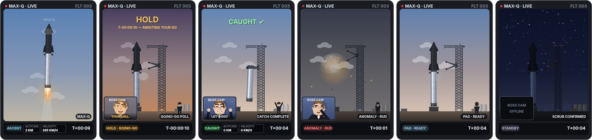

# MAX-Q

> Your AI coding agent, as a rocket launch livestream.

So here's the problem. When Claude Code needs your permission it just sits
there and waits, and if you're in another window you might not notice for like
ten minutes. That kept happening to me, so I made MAX-Q. It's a small card that
floats on top of your other windows on macOS and shows what your agent is
doing as a launch broadcast, so you can tell at a glance when it's waiting on
you.



## What each scene means

| Your agent is... | The card shows |
|---|---|
| **working** | **Ascent.** The rocket lifts off and climbs. The longer the task runs the higher it goes, until the sky turns into space. |
| **waiting for your permission** | **Hold.** The countdown freezes at T-10 with a big amber HOLD, basically the launch is waiting for your "go". This is the one you actually care about. |
| **back to work after you answer** | **Go given.** The countdown goes from 10 to 1 and the rocket lifts off. |
| **done with a long task** (3+ minutes) | **The catch.** The booster flies back and the launch tower's arms catch it. CAUGHT ✓ |
| **finished, nothing new yet** | **Pad ready.** The rocket is just sitting on the pad at golden hour. |
| **no session running** | **Standby.** Night at the pad, red lights blinking. |

There's also an **anomaly** scene (the rocket blows up, then it's back to the
pad). You'll only see it in tour mode or if you force it from the menu. Claude
Code's hooks don't give a reliable "something went wrong" signal, so MAX-Q
never shows it by itself. I'd rather have no alarm than a fake one.

**Click the card** and it jumps to the terminal of the session that needs you.

## Install

```bash
git clone https://github.com/lilwan345/maxq.git && cd maxq
pip install PySide6          # pyobjc is optional: it lets the card float over fullscreen apps
./install_hooks.sh           # connects MAX-Q to Claude Code (backs up settings.json first)
./run.sh
```

You need macOS, Python 3.10+ and [Claude Code](https://claude.com/claude-code).
Restart your Claude Code sessions after you install the hooks.

The **rocket icon in the menu bar** has tour mode (plays every scene one after
another), a way to force one scene, and live mode. You can drag the card around
and it remembers where you left it. A task counts as "long" after 180 seconds,
you can change that with `WISP_DONE_MIN_SEC`.

## How it works

1. **Claude Code hooks** (`hooks/write_state.sh`) run on events like "user sent
   a prompt", "tool used", "needs permission" and "stopped". Each one writes a
   tiny JSON file per session into `~/.ai-desktop-toy/sessions/`.
2. **The card** (`maxq.py`) reads those files twice a second. If you have a few
   sessions open it shows the most urgent one: waiting on you beats working,
   and working beats done and idle.
3. **False-alarm guard.** If the session's transcript got written *after* the
   permission request, that means you already answered it, so the card stops
   showing Hold.

Nothing leaves your machine. No API calls, no network.

All the rocket, tower and Earth art is drawn by `bake_vehicle.py` with NumPy
and Pillow, no AI-generated images. The flames, smoke and telemetry numbers get
drawn live every frame.

## Files

```
maxq.py            the card: state detection, scenes, menu-bar icon
hooks/             write_state.sh, the Claude Code hook
install_hooks.sh   adds the hook to ~/.claude/settings.json
bake_vehicle.py    draws the rocket, tower and Earth sprites into assets/vehicle/
run.sh             launcher
```

## Notes

- It's a fan homage to rocket launch streams, it isn't affiliated with any
  company and there's no real logos. The "boss cam" in the corner is a drawn
  cartoon, not a real person.
- [Beacon](https://github.com/lilwan345/beacon) reads the same session files
  but shows them as a calm lighthouse instead.

MIT, see [LICENSE](LICENSE).
